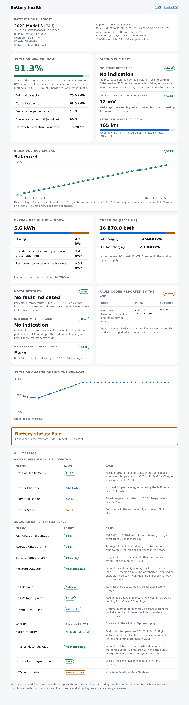
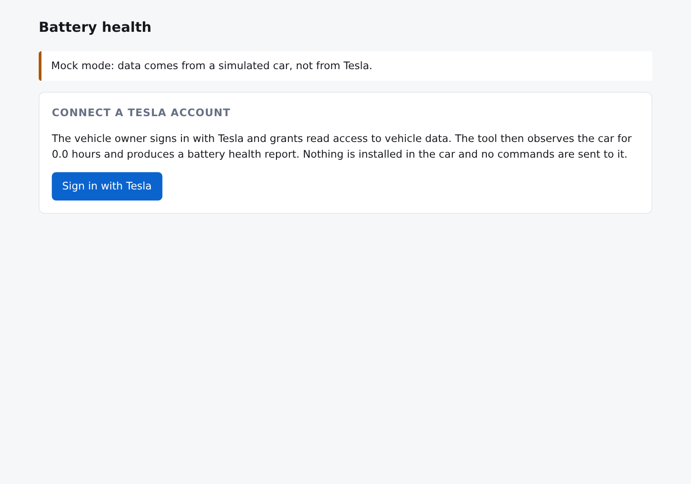
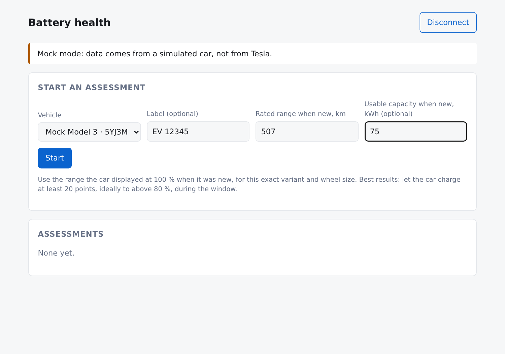
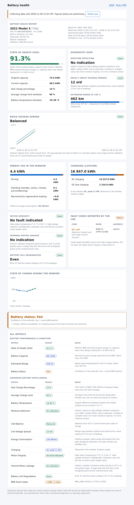
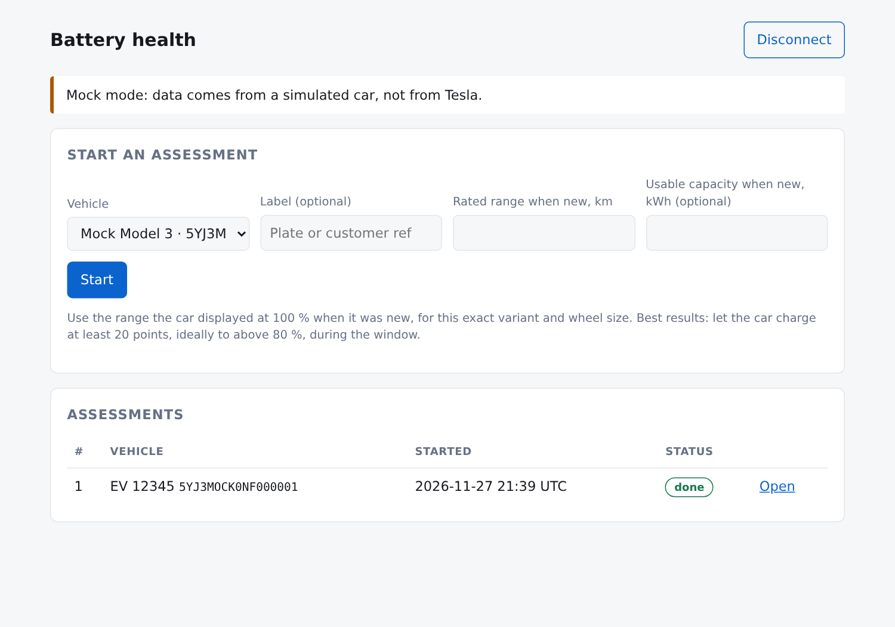

# Battery health

Self-hosted battery health reports for Tesla vehicles over Tesla's Fleet API.
The owner signs in with Tesla, the tool observes the car for 24 hours, and you
get a report (HTML, printable to PDF, and JSON). No dongle, no commands sent to the car.

**Sample report:** [examples/sample-report.html](examples/sample-report.html)
(self-contained; download or clone and open it in a browser) and the same data
as [examples/sample-report.json](examples/sample-report.json). Both come from
the built-in simulator, not a real car.

## How it works

1. **Connect.** The vehicle owner signs in with Tesla (OAuth, scope
   `vehicle_device_data`). Tokens are stored encrypted in SQLite, one account
   per Tesla user, and each user sees only their own assessments.

   

2. **Start an assessment.** Pick the car and enter the rated range it showed at
   100 % when new (and, optionally, usable capacity when new). These reference
   values are what state of health is measured against. A car can have one
   running assessment per user at a time.

   

3. **Observe.** A background sampler inside the web process polls the car for
   the length of the window (24 h by default). The report page is live from the
   first sample and marked preliminary until the window ends; "Finish now"
   closes the window early.

   

4. **Report.** When the window ends the report is frozen and kept. It is
   available as a page, as print/PDF, and as JSON at
   `/assessments/<id>/report.json`.

   

### How state of health is estimated

Two independent estimates from polling, plus the BMS's own figure when Fleet
Telemetry is on (`app/soh.py`, `app/metrics.py`):

- **Range method.** `battery_range / (battery_level / 100)` gives the rated
  range at 100 %; divided by the range when new it gives SoH. Samples below
  50 % charge or taken with a cold pack are left out.
- **Charge method.** Over one charging session of at least 20 points,
  `kWh added / share of charge gained` gives capacity; divided by capacity when
  new it gives SoH.
- **BMS nominal pack energy** (`NominalFullPackEnergyKwh` from Fleet Telemetry)
  is used as the headline figure when both it and capacity when new are known.

Confidence (high / medium / low) reflects how well the methods agree and how
many usable samples there were.

### Polling behaviour and cost

The sampler checks `GET /vehicles/{vin}` first and only calls `vehicle_data`
when the car is already online: every 15 min while charging, every 30 min
otherwise, so at most 96 billable data calls per assessment. It never wakes a
sleeping car on its own (`BH_ALLOW_WAKE=1` adds an optional single wake at start,
which needs a scope that permits it).

## What is measured, and from what

| Metric | Needs | Source | Kind |
|---|---|---|---|
| State of Health | login only | rated range at 100 % vs new; charge session; BMS nominal pack energy if telemetry is on | measured / BMS |
| Battery Capacity | login only | kWh added / SoC gained over a charge, or `NominalFullPackEnergyKwh` | measured / BMS |
| Estimated Range | login only | `battery_range` extrapolated to 100 % | BMS |
| Battery Status | login only | SoH bands + BMS alerts | derived |
| Fast Charge Percentage | telemetry | `LifetimeDcChargeEnergyKwh` / `LifetimeEnergyChargedKwh` | lifetime counter |
| Average Charge Limit | telemetry | `ChargeLimitSoc` | window only, not lifetime |
| Battery Temperature | telemetry | `ModuleTempMin/Max` | measured |
| Moisture Detection | telemetry | `IsolationResistance` stability | **proxy** |
| Cell Balance / Voltage Spread | telemetry | `BrickVoltageMax/Min`, `BrickSocMinPercent` | measured (brick level, not cell) |
| Energy Consumption | telemetry | `LifetimeEnergyUsed` / odometer | lifetime average |
| Charging | telemetry | AC/DC power, phases, session energy | measured |
| Motor Integrity | telemetry | stator temps, HVIL, drive-unit alerts | **indicators only** |
| Internal Motor Leakage | telemetry | isolation resistance driving vs parked | **proxy** |
| Battery Cell Degradation | telemetry | whether one brick is persistently the lowest | derived |
| BMS Fault Codes | login only | `recent_alerts` | reported by car |

Every report contains every metric. The "login only" rows work with the OAuth
login alone; the rest need Fleet Telemetry (below) and say "not collected"
without it. Status thresholds are constants at the top of `app/metrics.py`;
they are rules of thumb and should be tuned on cars you know.

Everything marked "window" covers only the time the assessment ran. For a
30-day picture set `BH_WINDOW_SECONDS=2592000` and rely on Fleet Telemetry;
raise `BH_IDLE_POLL_SECONDS` (e.g. 21600) so polling stays cheap over a long window.

Not available from Tesla's documented API, so not in the report: exact
production date, energy use split by feature (sentry, preconditioning, app,
summon, cabin overheat protection), range for other wheel sizes, and which
battery module a fault code refers to.

## Try it without a Tesla account

With Docker:

    docker build -t batteryhealth .
    docker run --rm -p 8000:8000 -e BH_MOCK=1 -e BH_POLL_SECONDS=1 \
      -e BH_IDLE_POLL_SECONDS=1 -e BH_WINDOW_SECONDS=40 batteryhealth

Or directly (Python 3.10+):

    pip install -r requirements.txt
    BH_MOCK=1 BH_POLL_SECONDS=1 BH_IDLE_POLL_SECONDS=1 BH_WINDOW_SECONDS=40 uvicorn app.main:app

Open http://localhost:8000, sign in, and start an assessment with range when
new 507 and capacity 75. The simulated car drives, naps, then charges to 90 %;
the report is done after 40 seconds.

    python -m pytest tests

## Testing with real car data

Every assessment writes a run log: one JSON line for each raw answer from the
car (connectivity checks, `vehicle_data`, `recent_alerts`, Fleet Telemetry
records) plus the reference values entered and the result the live run reached.
Files land in `BH_RUN_LOG_DIR` (`runs/` locally, `/data/runs` in the image),
one per assessment, named `<start time>-<VIN>-<id>.jsonl`. The line format is
described in `app/runlog.py`.

Replay a log through the current code, without Tesla or the database:

    python -m app.replay runs/20261127T213908Z-5YJ3...-1.jsonl

Turn a real run into a test fixture:

    python -m app.replay runs/<file>.jsonl --scrub tests/fixtures/model3-2022.jsonl

`--scrub` zeroes the VIN's serial number and drops account identifiers, tokens
and the car's name; raw run logs contain the full VIN and are git-ignored.
`tests/test_replay.py` replays every file in `tests/fixtures/` and fails if the
state of health no longer matches what the live run reported, so each recorded
car becomes a regression test. `mock-model3.jsonl` is a run of the simulator.

## Production setup

1. Create an application at developer.tesla.com (scope `vehicle_device_data`,
   redirect URI `https://<host>/auth/callback`). Fleet API is pay-per-use.
2. `python scripts/register_partner.py keygen`, deploy the app with
   `keys/public-key.pem` mounted at `/srv/keys/public-key.pem`, then
   `python scripts/register_partner.py register <host>`.
3. Run the container with the variables in `.env.example`:

       docker run -d --env-file .env -p 8000:8000 \
         -v batteryhealth-data:/data \
         -v "$PWD/keys/public-key.pem:/srv/keys/public-key.pem:ro" batteryhealth

   One replica only (SQLite + in-process sampler), with a persistent volume on
   `/data`. The process runs as UID 10001, so a bind mount or Kubernetes volume
   must be writable by that user (e.g. `fsGroup`/`chown 10001`); a Docker named
   volume works as is.
4. Put it behind TLS. `BH_BASIC_AUTH` is a minimal gate; prefer your SSO proxy,
   but leave `/.well-known/`, `/auth/callback` and `/ingest/` reachable as needed.
   `GET /healthz` is the liveness/readiness endpoint.

### Configuration

| Variable | Default | Purpose |
|---|---|---|
| `BH_SECRET_KEY` | none | Signs sessions and encrypts stored tokens. **Required** (at least 16 characters) unless `BH_MOCK=1`; the app refuses to start without it. Changing it later makes stored tokens unreadable. |
| `BH_TESLA_CLIENT_ID`, `BH_TESLA_CLIENT_SECRET` | – | Tesla developer application. |
| `BH_TESLA_REDIRECT_URI` | `http://localhost:8000/auth/callback` | Must match the application; an `https://` value also makes the session cookie secure-only. |
| `BH_TESLA_FLEET_BASE` | EU Fleet API | OAuth audience and fallback regional base URL. |
| `BH_TESLA_SCOPES` | `openid offline_access vehicle_device_data` | |
| `BH_PUBLIC_KEY_PATH` | `keys/public-key.pem` | Served at `/.well-known/appspecific/com.tesla.3p.public-key.pem`. |
| `BH_BASIC_AUTH` | off | `user:pass` gate in front of the UI. |
| `BH_INGEST_TOKEN` | off | Bearer token for `/ingest/telemetry`; the endpoint is closed without it. |
| `BH_DB_PATH` | `/data/batteryhealth.db` in the image | SQLite file. |
| `BH_RUN_LOG_DIR` | `runs` (`/data/runs` in the image) | Raw run logs, one file per assessment. Empty disables. |
| `BH_WINDOW_SECONDS` | `86400` | Observation window. |
| `BH_POLL_SECONDS` / `BH_IDLE_POLL_SECONDS` | `900` / `1800` | Poll interval while charging / otherwise. |
| `BH_LATE_TELEMETRY_SECONDS` | `21600` | How long after the window late telemetry may still rebuild a finished report. |
| `BH_ALLOW_WAKE` | `0` | Offer a single wake-up at the start of an assessment. |
| `BH_MOCK` | `0` | Simulated car instead of Tesla. |

### Fleet Telemetry (everything beyond the "login only" metrics)

1. Run Tesla's `fleet-telemetry` server (mTLS, public on 443) and the
   `vehicle-command` HTTP proxy with `keys/private-key.pem`.
2. The owner pairs your virtual key: `https://tesla.com/_ak/<host>`.
3. Send `scripts/telemetry_fields.json` as the `fields` of
   `POST /api/1/vehicles/fleet_telemetry_config` through the proxy; wait for `synced`.
4. Forward records from your dispatcher (Kafka/MQTT/...) to
   `POST /ingest/telemetry` with `Authorization: Bearer $BH_INGEST_TOKEN`.
   Both the flat form and fleet-telemetry's decoded JSON records are accepted
   (see the docstring in `app/main.py`). Signals are matched to an assessment by VIN and time.
   The car buffers telemetry while it is out of coverage, so records timestamped
   inside a window that arrive up to 6 hours after it closed
   (`BH_LATE_TELEMETRY_SECONDS`) rebuild the finished report.

## Known gaps

- **Not verified against Tesla.** Everything was exercised against the built-in
  simulator, not a real car or a real Tesla developer account. Check on first
  contact with real data: the `recent_alerts` response shape, units of
  `IsolationResistance` and the temperature signals, and whether `users/region`
  works with your scopes.
- **Accounts are keyed on the Tesla user id** read from the sign-in's
  `id_token`. If Tesla's token response carries no `id_token`, each sign-in
  becomes a new account and earlier assessments are not listed after signing in
  again. Not yet confirmed against a real Tesla account.
- **No retention.** Telemetry rows, samples, tokens and run logs are kept until deleted by hand.
- `/ingest/telemetry` answers 500 rather than 400 on a malformed body.

## Layout

    app/main.py        routes, OAuth callback, telemetry ingest
    app/worker.py      background sampler and report assembly
    app/soh.py         state-of-health estimation (pure functions, tested)
    app/metrics.py     metric table, thresholds, energy and brick series
    app/tesla.py       Fleet API client      app/mock.py   simulator
    app/db.py          SQLite schema, token encryption
    app/runlog.py      per-assessment log of raw answers from the car
    app/replay.py      recompute a report from a run log; scrub logs into fixtures
    tests/fixtures/    recorded runs replayed by the tests
    scripts/           partner registration, telemetry field list
    examples/          screenshots and a sample report
